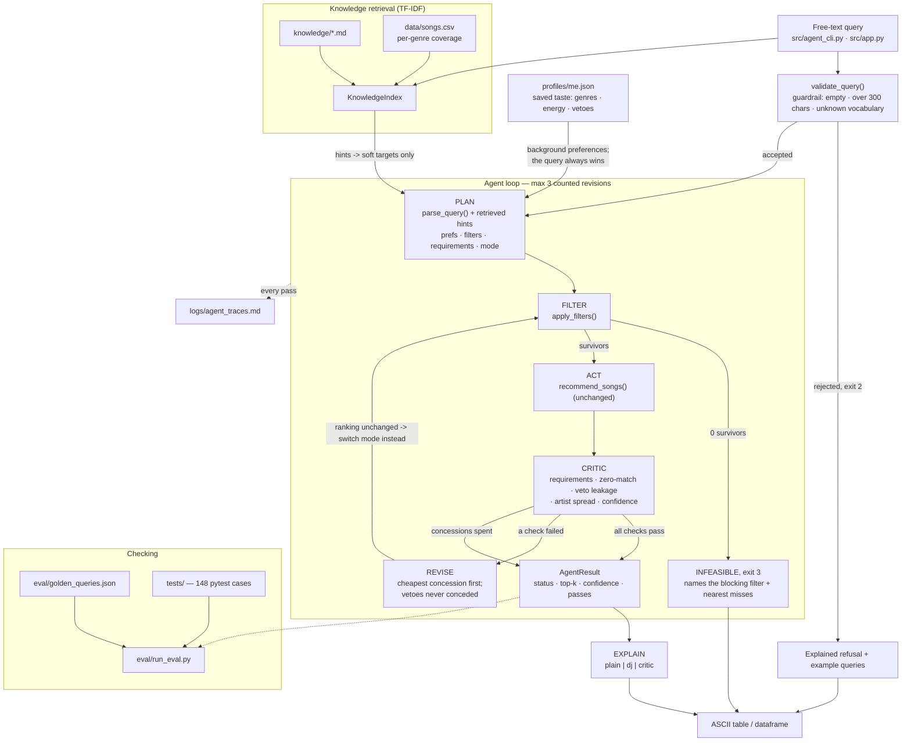

# 🎵 Agentic Music Recommender

An applied AI system that turns a plain-English listening request into an explained,
self-checked set of recommendations. It plans a search, prunes the catalog against hard
requirements, scores what survives, criticises its own answer, and revises when something
the listener asked for was not delivered — then says so plainly when it has to give
something up.

```
$ python -m src.agent_cli "1990s instrumental hip-hop"
Status: BEST EFFORT | confidence 0.31 | 1 revision(s) | 2 pass(es)
Agent: Best effort: the catalog has nothing matching genre = hip-hop, so that part of
the request was given up. Everything else still holds.
```

---

## The base project this extends

**Base project: Music Recommender Simulation (AI110 Module 3).**

The Module 3 project was a deterministic, content-based recommender. It loaded a 20-song
catalog from `data/songs.csv`, compared every song against a hand-written listener
preference dictionary, and returned the top 5 with a score and a plain-language reason for
every point awarded. It offered three swappable ranking modes built with the Strategy
pattern and a diversity re-ranker that penalised repeated artists and over-represented
genres.

Its limits were the starting point for this project: the only way to use it was to edit a
Python dictionary in `src/main.py`, it could not express a hard requirement (only
preferences with weights), it never checked whether its own answer actually matched the
request, and two columns in the catalog — `instrumentalness` and `speechiness` — carried no
weight at all, so no request could act on them.

## What is new in this version

| Component | What it adds | Where |
|---|---|---|
| **Agent loop** (the required AI feature) | Plans a search from free text, acts, critiques its own result, and revises up to 3 times | `src/agent/loop.py` |
| **Natural-language planner** | Rule-based parsing over the catalog's closed vocabulary into prefs, hard filters and requirements | `src/agent/query_parser.py` |
| **Hard-constraint filter stage** | Prunes the catalog *before* scoring, which makes "instrumental" or "nothing too poppy" actually enforceable | `src/agent/constraints.py` |
| **Self-critique + confidence** | Reports every check it runs, scores confidence, and distinguishes "accepted" from "best effort" | `src/agent/critic.py` |
| **Revision policy** | Concedes the cheapest thing first; never concedes an explicit veto | `src/agent/planner.py` |
| **Knowledge retrieval (RAG)** | Pure-Python TF-IDF over hand-written notes plus catalog-derived facts, feeding the planner | `src/agent/knowledge.py`, `src/agent/hints.py` |
| **Explanation voices** | Three constrained styles over the scorer's own reasons | `src/agent/voices.py` |
| **Evaluation harness** | 20 golden cases asserting behaviour, with a pass/fail summary and non-zero exit on regression | `eval/run_eval.py` |
| **Reasoning traces** | Every pass written to a committed log | `src/agent/trace.py`, `logs/agent_traces.md` |
| **Saved taste profile** | Background preferences the agent carries into every query, with vetoes it will not concede | `src/agent/profile.py` |
| **Interfaces** | CLI (reference) and a Streamlit page | `src/agent_cli.py`, `src/app.py` |

The original scorer and ranker (`score_song`, `recommend_songs`) are still the engine; the
agent wraps them rather than replacing them. The only change inside the old code was giving
`instrumentalness` and `speechiness` weights in all three ranking modes, so the new filter
stage has something to act on.

---

## Architecture

The Mermaid source of record is [`diagrams/architecture.mmd`](diagrams/architecture.mmd).



**How to read it.** A query is validated before anything else; an empty, overlong or
unrecognisable query is refused with examples rather than guessed at. What survives is
parsed into a plan: *soft preferences* that influence scoring, *hard filters* that prune,
and *requirements* that the critic will hold the answer to. Retrieval runs beside the
parser and can only add soft targets the listener did not state. The filter stage prunes the
catalog; if nothing survives, the system reports which requirement emptied it and names the
closest available songs instead of returning filler. Survivors go through the original
scorer and diversity re-ranker. The critic then checks the result against the plan, and the
planner concedes the cheapest thing that could unblock it. Humans enter in two places: the
golden cases in `eval/golden_queries.json` encode expected behaviour, and the human review
table in [`model_card.md`](model_card.md) records a manual pass over the output.

### Why a separate filter stage

Weighted scoring cannot express a hard requirement. Asking for instrumental music by
raising a weight still lets a vocal track win on other features, and before this project
`instrumentalness` had no weight at all. Splitting the two means a stated threshold is
enforced by pruning, while taste stays a matter of weights — and it gives the system a
truthful answer available nowhere in the original design: *nothing in the catalog satisfies
this*.

---

## Setup

Requires Python 3.9+ (developed on 3.12). From the project root:

```bash
git clone <this-repo-url>
cd applied-ai-system-final

python3 -m venv .venv
source .venv/bin/activate        # Windows: .venv\Scripts\activate

pip install -r requirements.txt
```

No API keys, no network access and no model downloads: the planner, retriever and
explanation voices are all deterministic local code. Two consequences worth stating up
front — the same query always produces the same answer, and the system understands only the
vocabulary of its own catalog.

Verify the install:

```bash
python -m pytest -q          # 148 tests
python eval/run_eval.py      # 20 golden cases, exits non-zero on regression
```

---

## Usage

```bash
python -m src.agent_cli "chill lofi for studying"

# options
python -m src.agent_cli "QUERY" --trace          # print the full reasoning trace
python -m src.agent_cli "QUERY" --voice critic   # plain (default) | dj | critic
python -m src.agent_cli "QUERY" --me             # apply your saved taste profile
python -m src.agent_cli "QUERY" --profile PATH   # apply a specific profile file
python -m src.agent_cli "QUERY" --no-rag         # skip knowledge retrieval
python -m src.agent_cli "QUERY" --mode balanced  # force a ranking mode
python -m src.agent_cli "QUERY" -k 3             # how many songs
python -m src.agent_cli "QUERY" --no-log         # do not append to logs/agent_traces.md

streamlit run src/app.py                         # same agent, browser UI
python -m src.main                               # the original Module 3 experiments
```

Exit codes: `0` answered (accepted or best effort), `1` catalog could not be loaded,
`2` query refused by the guardrail, `3` request infeasible against this catalog,
`4` profile file missing or invalid.

Every run appends its reasoning trace to `logs/agent_traces.md`, which is append-only by
design so a session's history survives.

---

## Sample interactions

All output below is copied from a real run. The full set is in
[`logs/demo_run.txt`](logs/demo_run.txt); traces are in
[`logs/agent_traces.md`](logs/agent_traces.md).

### 1. A request the catalog can satisfy — accepted on the first pass

```text
$ python -m src.agent_cli "high energy hip hop to hype me up" -k 5
Query: "high energy hip hop to hype me up"
Status: ACCEPTED | confidence 1.00 | 0 revision(s) | 1 pass(es)
Agent: Every requirement in the query was satisfied on the first attempt.
Final plan: energy=0.9, danceability=0.85, tempo_bpm=150.0, genre=hip-hop | mode vibe_and_energy
Retrieved: 'Workouts, gym sessions and hype' (use_cases.md, similarity 0.13) -> energy=0.9, danceability=0.85, tempo_bpm=150.0, mode=vibe_and_energy

+------+-------------+---------------+---------+-------+--------------------------------------+
| Rank | Song Title  | Artist        | Genre   | Score | Reasons                              |
+======+=============+===============+=========+=======+======================================+
|    1 | Stronger    | Kanye West    | hip-hop |  5.40 | Genre match: hip-hop (+0.75)         |
|      |             |               |         |       | Energy proximity: 0.95 (+2.85)       |
|      |             |               |         |       | Danceability proximity: 0.93 (+1.4)  |
|      |             |               |         |       | Tempo proximity: 0.54 (+0.41)        |
+------+-------------+---------------+---------+-------+--------------------------------------+
|    2 | Best Friend | Young Thug    | hip-hop |  5.40 | Genre match: hip-hop (+0.75)         |
|      |             |               |         |       | Energy proximity: 0.84 (+2.52)       |
|      |             |               |         |       | Danceability proximity: 0.97 (+1.46) |
|      |             |               |         |       | Tempo proximity: 0.90 (+0.68)        |
+------+-------------+---------------+---------+-------+--------------------------------------+
|    3 | Gym Hero    | Max Pulse     | pop     |  4.98 | Energy proximity: 0.97 (+2.91)       |
|      |             |               |         |       | Danceability proximity: 0.97 (+1.46) |
|      |             |               |         |       | Tempo proximity: 0.82 (+0.61)        |
+------+-------------+---------------+---------+-------+--------------------------------------+
|    4 | Drop Zone   | Kilowatt Kids | edm     |  4.95 | Energy proximity: 0.93 (+2.79)       |
|      |             |               |         |       | Danceability proximity: 0.99 (+1.48) |
|      |             |               |         |       | Tempo proximity: 0.90 (+0.68)        |
+------+-------------+---------------+---------+-------+--------------------------------------+
|    5 | Idol        | YOASOBI       | j-pop   |  4.93 | Energy proximity: 1.00 (+3.0)        |
|      |             |               |         |       | Danceability proximity: 0.87 (+1.3)  |
... (full output in logs/demo_run.txt)
```

### 2. An over-constrained request — the agent revises, then says what it gave up

The catalog has no chill acoustic music from the 1990s. Rather than silently returning
something else, the agent relaxes the least specific requirement first, notices when a
concession changed nothing and switches ranking strategy instead, and finally reports
**best effort** with the surrendered requirements named.

```text
$ python -m src.agent_cli "chill acoustic 90s stuff for studying, nothing too poppy" --trace
Query: "chill acoustic 90s stuff for studying, nothing too poppy"
Status: BEST EFFORT | confidence 0.42 | 1 revision(s) | 5 pass(es)
Agent: Best effort: the catalog has nothing matching mood = chill, release decade = 1990s, so that part of the request was given up. Everything else still holds.
Final plan: acousticness=0.7, instrumentalness=0.1, genre=acoustic, energy=0.3 | mode genre_first
Retrieved: 'acoustic in this catalog' (data/songs.csv, similarity 0.20) -> no usable hints
Retrieved: 'Acoustic, indie rock and indie pop' (genres.md, similarity 0.15) -> acousticness=0.7, instrumentalness=0.1


### Reasoning trace

- **Pass 1** — mode `vibe_and_energy`, 29 song(s) survived the filter stage
    - PLAN: acousticness=0.7, instrumentalness=0.1, genre=acoustic, mood=chill, release_decade=1990s, energy=0.3
    - FILTERS: exclude genre pop
    - REQUIREMENTS: genre = acoustic; mood = chill; release decade = 1990s
    - ACT: Porch Light Letters (5.98), Midnight Coding (5.96), Library Rain (5.96), Spacewalk Thoughts (5.95), Jaba Jaba Mutu Bhitra (5.37)
    - CRITIC: 5/7 checks passed, confidence 0.67
    - PROBLEMS: top pick has mood='relaxed', wanted 'chill'; top pick has release_decade='2000s', wanted '1990s'
    - ACTION: revise: relaxed release decade = 1990s
- **Pass 2** — mode `vibe_and_energy`, 29 song(s) survived the filter stage
    - PLAN: acousticness=0.7, instrumentalness=0.1, genre=acoustic, mood=chill, energy=0.3
    - FILTERS: exclude genre pop
    - REQUIREMENTS: genre = acoustic; mood = chill
    - ACT: Porch Light Letters (5.98), Midnight Coding (5.96), Library Rain (5.96), Spacewalk Thoughts (5.95), Jaba Jaba Mutu Bhitra (5.37)
    - CRITIC: 5/6 checks passed, confidence 0.64
    - PROBLEMS: top pick has mood='relaxed', wanted 'chill'
    - ACTION: no-op concession, trying next: switched ranking mode to balanced
- **Pass 3** — mode `balanced`, 29 song(s) survived the filter stage
    - PLAN: acousticness=0.7, instrumentalness=0.1, genre=acoustic, mood=chill, energy=0.3
    - FILTERS: exclude genre pop
    - REQUIREMENTS: genre = acoustic; mood = chill
    - ACT: Porch Light Letters (5.24), Midnight Coding (4.03), Library Rain (3.94), Spacewalk Thoughts (3.90), Jaba Jaba Mutu Bhitra (3.40)
    - CRITIC: 5/6 checks passed, confidence 0.64
    - PROBLEMS: top pick has mood='relaxed', wanted 'chill'
    - ACTION: no-op concession, trying next: switched ranking mode to genre_first
- **Pass 4** — mode `genre_first`, 29 song(s) survived the filter stage
    - PLAN: acousticness=0.7, instrumentalness=0.1, genre=acoustic, mood=chill, energy=0.3
    - FILTERS: exclude genre pop
    - REQUIREMENTS: genre = acoustic; mood = chill
    - ACT: Porch Light Letters (5.87), Midnight Coding (2.48), Library Rain (2.46), Spacewalk Thoughts (2.44), Jaba Jaba Mutu Bhitra (1.95)
... (full trace in logs/agent_traces.md)
```

### 3. An impossible combination — explained infeasibility instead of filler

```text
$ python -m src.agent_cli "instrumental lyrical music"
Query: "instrumental lyrical music"
Status: INFEASIBLE | confidence 0.00 | 0 revision(s) | 0 pass(es)
Agent: No song in the catalog satisfies every hard requirement: speechiness at least 0.1 (removes 24 of 31); instrumentalness at least 0.5 (removes 23 of 31). Closest available: Best Friend (hip-hop, fails instrumentalness at least 0.5); Blue Note Taxi (jazz, fails speechiness at least 0.1). Relax one of those requirements and ask again.

Trace appended to logs/agent_traces.md
[exit code: 3]
```

### 4. A contradiction the catalog *can* partly serve — the hard filter survives revision

Asking for 1990s instrumental hip-hop is unsatisfiable: hip-hop in this catalog has
`instrumentalness` of 0.00–0.01. The agent keeps the instrumental filter, surrenders the
genre, and reports low confidence (0.31) to signal that it did not get what was asked.

```text
$ python -m src.agent_cli "1990s instrumental hip-hop" --voice critic
Query: "1990s instrumental hip-hop"
Status: BEST EFFORT | confidence 0.35 | 1 revision(s) | 2 pass(es)
Agent: Best effort: the catalog has nothing matching genre = hip-hop, so that part of the request was given up. Everything else still holds.
Final plan: speechiness=0.25, danceability=0.8, release_decade=1990s | mode genre_first
Retrieved: 'hip-hop in this catalog' (data/songs.csv, similarity 0.44) -> no usable hints
Retrieved: 'Hip-hop and rap' (genres.md, similarity 0.36) -> speechiness=0.25, danceability=0.8

+------+---------------------+---------------+-----------+-------+--------------------------------------+
| Rank | Song Title          | Artist        | Genre     | Score | Reasons                              |
+======+=====================+===============+===========+=======+======================================+
|    1 | Coffee Shop Stories | Slow Stereo   | jazz      |  1.07 | Decade match: 1990s (+0.5)           |
|      |                     |               |           |       | Danceability proximity: 0.74 (+0.37) |
|      |                     |               |           |       | Speechiness proximity: 0.79 (+0.2)   |
+------+---------------------+---------------+-----------+-------+--------------------------------------+
|    2 | Drop Zone           | Kilowatt Kids | edm       |  0.67 | Danceability proximity: 0.94 (+0.47) |
|      |                     |               |           |       | Speechiness proximity: 0.81 (+0.2)   |
+------+---------------------+---------------+-----------+-------+--------------------------------------+
|    3 | Night Drive Loop    | Neon Echo     | synthwave |  0.66 | Danceability proximity: 0.93 (+0.46) |
|      |                     |               |           |       | Speechiness proximity: 0.79 (+0.2)   |
+------+---------------------+---------------+-----------+-------+--------------------------------------+
|    4 | Midnight Coding     | LoRoom        | lofi      |  0.60 | Danceability proximity: 0.82 (+0.41) |
|      |                     |               |           |       | Speechiness proximity: 0.78 (+0.2)   |
+------+---------------------+---------------+-----------+-------+--------------------------------------+
... (full output in logs/demo_run.txt)
```

---

## Reliability, guardrails and evaluation

Four mechanisms, each visible in the output above.

| Mechanism | Behaviour | Evidence |
|---|---|---|
| **Input guardrail** | Empty, over-300-character or unrecognisable queries are refused with examples, exit code 2 | Cases 5–6 below |
| **Hard-constraint filter** | A stated threshold or exclusion prunes the catalog; an empty result is reported as infeasible with the blocking constraint named | Sample interaction 3 |
| **Self-critique + honest status** | Every check is reported; acceptance reached only by surrendering requirements is reported as `best_effort`, never `accepted` | Sample interactions 2 and 4 |
| **Evaluation harness** | 20 golden cases assert status, revision bounds, confidence floors, forbidden genres and per-field thresholds | Table below |

### Guardrail behaviour

| Input | Expected behaviour | Result |
|---|---|---|
| `""` (empty) | Refuse, explain, suggest examples | Pass — exit 2, "Query was empty" |
| `"asdfghjkl qwerty"` | Refuse: no recognisable vocabulary | Pass — exit 2, lists example queries |
| `"chill lofi " × 40` (440 chars) | Refuse: too long | Pass — exit 2, states the 300-char limit |
| `"instrumental lyrical music"` | Infeasible, name the blocker | Pass — exit 3, names both filters and the closest song |
| `--top 0` | Refuse a nonsense result count | Pass — exit 2, "--top must be at least 1" |

```text
$ python -m src.agent_cli ""
Query: ""
Status: REJECTED | confidence 0.00 | 0 revision(s) | 0 pass(es)
Agent: Query was empty. Describe the music you want.
Try something like:
  - chill lofi for studying
  - high energy hip hop to hype me up
  - moody 1990s jazz, nothing too poppy

Trace appended to logs/agent_traces.md
[exit code: 2]
```

```text
$ python -m src.agent_cli "asdfghjkl qwerty"
Query: "asdfghjkl qwerty"
Status: REJECTED | confidence 0.00 | 0 revision(s) | 0 pass(es)
Agent: Could not recognise any genre, mood, decade or listening situation in that query.
Try something like:
  - chill lofi for studying
  - high energy hip hop to hype me up
  - moody 1990s jazz, nothing too poppy

Trace appended to logs/agent_traces.md
[exit code: 2]
```

### Evaluation harness

```text
$ python -m src.agent_cli "something for deep focus while coding" --no-rag -k 3
Query: "something for deep focus while coding"
Status: ACCEPTED | confidence 0.80 | 0 revision(s) | 1 pass(es)
Agent: Every requirement in the query was satisfied on the first attempt.
Final plan: energy=0.3 | mode vibe_and_energy

+------+-----------------------+---------------+----------+-------+--------------------------------+
| Rank | Song Title            | Artist        | Genre    | Score | Reasons                        |
+======+=======================+===============+==========+=======+================================+
|    1 | Porch Light Letters   | Willow & Pine | acoustic |  3.00 | Energy proximity: 1.00 (+3.0)  |
+------+-----------------------+---------------+----------+-------+--------------------------------+
|    2 | Jaba Jaba Mutu Bhitra | Arun Thapa    | nepali   |  3.00 | Energy proximity: 1.00 (+3.0)  |
+------+-----------------------+---------------+----------+-------+--------------------------------+
|    3 | Spacewalk Thoughts    | Orbit Bloom   | ambient  |  2.94 | Energy proximity: 0.98 (+2.94) |
+------+-----------------------+---------------+----------+-------+--------------------------------+

Why these (plain voice):
  1. Porch Light Letters: the energy is close to your target.
  2. Jaba Jaba Mutu Bhitra: the energy is close to your target.
  3. Spacewalk Thoughts: the energy is close to your target.

Trace appended to logs/agent_traces.md
... (full output in logs/demo_run.txt)
```

Mean confidence of 0.62 across the suite is low on purpose: a third of the cases are
guardrail refusals and deliberate near-misses that *should* score 0.00.

Writing this harness paid for itself immediately — two of my own expectations were wrong
and the system was right. I had asserted that `"moody 1990s jazz"` would be accepted, but
the catalog's only 1990s jazz track is `relaxed`, not `moody`, so reporting best effort is
correct. And my "too long" case was exactly 300 characters, which is not over the limit.

### Automated tests

```bash
$ python -m pytest -q
148 passed
```

Coverage is 89% overall and 90–100% on every `src/agent` module. The gap is
`src/app.py` (33%), whose Streamlit body cannot run outside a Streamlit process; its pure
helpers are tested. To reproduce the figure, install the optional dev tool and run:

```bash
pip install pytest-cov
python -m pytest -q --cov=src --cov=eval --cov-report=term-missing
```

---

## Stretch features

### RAG enhancement: multi-source retrieval that changes the ranking

Two sources are indexed: hand-written notes in `knowledge/` (editorial judgements the song
columns cannot express, such as "focus listening means near-instrumental") and per-genre
coverage summaries derived from `data/songs.csv`. Retrieved passages carry explicit
`hint:` directives that become soft scoring targets, so retrieval changes what gets ranked
first rather than just printing a note beside the answer.

**Before and after, same query, one flag apart.** `"something for deep focus while coding"`
mentions no genre, so without retrieval the planner has only an energy target to work with
and ranks a *vocal* acoustic track first — wrong for coding.

```text
$ python -m src.agent_cli "something for deep focus while coding" -k 3
Query: "something for deep focus while coding"
Status: ACCEPTED | confidence 0.99 | 0 revision(s) | 1 pass(es)
Agent: Every requirement in the query was satisfied on the first attempt.
Final plan: instrumentalness=0.95, speechiness=0.0, energy=0.3 | mode vibe_and_energy
Retrieved: 'Deep focus, studying and coding' (use_cases.md, similarity 0.39) -> instrumentalness=0.95, speechiness=0.0, energy=0.3, mode=vibe_and_energy

+------+--------------------+----------------+---------+-------+------------------------------------------+
| Rank | Song Title         | Artist         | Genre   | Score | Reasons                                  |
+======+====================+================+=========+=======+==========================================+
|    1 | Spacewalk Thoughts | Orbit Bloom    | ambient |  4.93 | Energy proximity: 0.98 (+2.94)           |
|      |                    |                |         |       | Instrumentalness proximity: 1.00 (+1.5)  |
|      |                    |                |         |       | Speechiness proximity: 0.98 (+0.49)      |
+------+--------------------+----------------+---------+-------+------------------------------------------+
|    2 | Library Rain       | Paper Lanterns | lofi    |  4.79 | Energy proximity: 0.95 (+2.85)           |
|      |                    |                |         |       | Instrumentalness proximity: 0.97 (+1.46) |
|      |                    |                |         |       | Speechiness proximity: 0.97 (+0.48)      |
+------+--------------------+----------------+---------+-------+------------------------------------------+
|    3 | Focus Flow         | LoRoom         | lofi    |  4.61 | Energy proximity: 0.90 (+2.7)            |
|      |                    |                |         |       | Instrumentalness proximity: 0.95 (+1.43) |
|      |                    |                |         |       | Speechiness proximity: 0.97 (+0.48)      |
+------+--------------------+----------------+---------+-------+------------------------------------------+

Why these (plain voice):
  1. Spacewalk Thoughts: the energy is close to your target, there is little or no singing and it is sung rather than spoken.
  2. Library Rain: the energy is close to your target, there is little or no singing and it is sung rather than spoken.
... (full output in logs/demo_run.txt)
```

With retrieval, the focus passage contributes `instrumentalness = 0.95` and
`speechiness = 0.0`; the instrumental tracks take the top three and the vocal track leaves
the list entirely.

```text
$ python eval/run_eval.py
Agent evaluation harness — 20 cases, catalog of 31 songs

Case                                          RAG  Profile  Status       Expected     Conf  Rev  Result
--------------------------------------------  ---  -------  -----------  -----------  ----  ---  ------
easy_genre_and_energy                         off  -        accepted     accepted     0.86  0    PASS
study_lofi                                    off  -        accepted     accepted     1.00  0    PASS
over_constrained_self_corrects                off  -        best_effort  best_effort  0.36  2    PASS
instrumental_filter_survives_revision         off  -        best_effort  best_effort  0.31  1    PASS
obscure_instrumental_coding                   off  -        accepted     accepted     0.79  0    PASS
decade_and_genre                              off  -        best_effort  best_effort  0.54  1    PASS
mood_only                                     off  -        accepted     accepted     0.65  0    PASS
veto_is_honoured                              off  -        accepted     accepted     0.65  0    PASS
contradictory_filters_are_infeasible          off  -        infeasible   infeasible   0.00  0    PASS
empty_query_rejected                          off  -        rejected     rejected     0.00  0    PASS
gibberish_rejected                            off  -        rejected     rejected     0.00  0    PASS
overlong_query_rejected                       off  -        rejected     rejected     0.00  0    PASS
rag_focus_prefers_instrumental                on   -        accepted     accepted     0.99  0    PASS
no_rag_focus_admits_a_vocal_track             off  -        accepted     accepted     0.80  0    PASS
rag_gym_query_targets_high_energy             on   -        accepted     accepted     1.00  0    PASS
rag_over_constrained_still_self_corrects      on   -        best_effort  best_effort  0.42  1    PASS
profile_supplies_genres_the_query_omits       on   me       accepted     accepted     1.00  0    PASS
profile_veto_outranks_a_better_scoring_genre  on   me       accepted     accepted     0.94  0    PASS
query_overrides_the_profile_veto              on   me       accepted     accepted     1.00  0    PASS
profile_adds_nepali_and_jpop_vocabulary       on   -        accepted     accepted     1.00  0    PASS

20/20 cases passed | mean confidence 0.62 | 3 guardrail rejection(s)
```

Retrieval may only *add* targets the listener did not state, and may never create a hard
filter — inferring a veto from a similarity score would silently hide songs.

### Personalization: a saved taste profile

`profiles/me.json` holds background taste — favourite genres, usual energy, genres to skip.
Precedence never varies:

```
what you typed  >  your saved profile  >  the knowledge corpus
```

A profile contributes *preferences*, never requirements, so the critic can never fail a
result for missing something you did not ask for today. The exception is `avoid_genres`,
which becomes a veto the planner will not concede — and even that yields to the query:
asking for a genre you normally skip overrides the veto for that run.

The catalog was also extended from 20 to 31 songs with tracks this listener actually plays,
which added three genres (`hip-hop` entries by Kanye West and Young Thug, `nepali` classics
by Narayan Gopal, Arun Thapa and Aruna Lama, and `j-pop`/`city pop` from Kenshi Yonezu,
YOASOBI and Mariya Takeuchi) and two decades (1970s, 1980s). The audio-feature values for
these added rows are **hand-estimated by ear, not measured** — they are good enough to rank
with and should not be quoted as data.

**Same query, profile off then on.** Generic, the gym query returns whatever scores highest
on energy and danceability:

```text
$ python -m src.agent_cli "something for the gym" -k 3
Query: "something for the gym"
Status: ACCEPTED | confidence 1.00 | 0 revision(s) | 1 pass(es)
Agent: Every requirement in the query was satisfied on the first attempt.
Final plan: energy=0.9, danceability=0.85, tempo_bpm=150.0 | mode vibe_and_energy
Retrieved: 'Workouts, gym sessions and hype' (use_cases.md, similarity 0.18) -> energy=0.9, danceability=0.85, tempo_bpm=150.0, mode=vibe_and_energy

+------+------------+---------------+-------+-------+--------------------------------------+
| Rank | Song Title | Artist        | Genre | Score | Reasons                              |
+======+============+===============+=======+=======+======================================+
|    1 | Gym Hero   | Max Pulse     | pop   |  4.98 | Energy proximity: 0.97 (+2.91)       |
|      |            |               |       |       | Danceability proximity: 0.97 (+1.46) |
|      |            |               |       |       | Tempo proximity: 0.82 (+0.61)        |
+------+------------+---------------+-------+-------+--------------------------------------+
|    2 | Drop Zone  | Kilowatt Kids | edm   |  4.95 | Energy proximity: 0.93 (+2.79)       |
|      |            |               |       |       | Danceability proximity: 0.99 (+1.48) |
|      |            |               |       |       | Tempo proximity: 0.90 (+0.68)        |
+------+------------+---------------+-------+-------+--------------------------------------+
|    3 | Idol       | YOASOBI       | j-pop |  4.93 | Energy proximity: 1.00 (+3.0)        |
|      |            |               |       |       | Danceability proximity: 0.87 (+1.3)  |
|      |            |               |       |       | Tempo proximity: 0.84 (+0.63)        |
+------+------------+---------------+-------+-------+--------------------------------------+
... (full output in logs/demo_run.txt)
```

With the profile applied, EDM is vetoed out despite being the highest-energy genre in the
catalog, and the listener's own genres take all three slots:

```text
$ python -m src.agent_cli "something for the gym" --me -k 3
Profile: Sakxam — genres hip-hop/nepali/j-pop/city pop, usual energy 0.55, likes hits, skips jazz/edm
Query: "something for the gym"
Status: ACCEPTED | confidence 1.00 | 0 revision(s) | 1 pass(es)
Agent: Every requirement in the query was satisfied on the first attempt.
Final plan: energy=0.9, danceability=0.85, tempo_bpm=150.0, genre=hip-hop/nepali/j-pop/city pop, prefers_popular=True | mode vibe_and_energy
From profile: Sakxam contributed genre=hip-hop/nepali/j-pop/city pop, prefers_popular=True
Retrieved: 'Workouts, gym sessions and hype' (use_cases.md, similarity 0.18) -> energy=0.9, danceability=0.85, tempo_bpm=150.0, mode=vibe_and_energy

+------+-------------+------------+---------+-------+--------------------------------------+
| Rank | Song Title  | Artist     | Genre   | Score | Reasons                              |
+======+=============+============+=========+=======+======================================+
|    1 | Idol        | YOASOBI    | j-pop   |  5.91 | Genre match: j-pop (+0.75)           |
|      |             |            |         |       | Energy proximity: 1.00 (+3.0)        |
|      |             |            |         |       | Danceability proximity: 0.87 (+1.3)  |
|      |             |            |         |       | Tempo proximity: 0.84 (+0.63)        |
|      |             |            |         |       | Popularity bonus: 90 (+0.23)         |
+------+-------------+------------+---------+-------+--------------------------------------+
|    2 | Stronger    | Kanye West | hip-hop |  5.63 | Genre match: hip-hop (+0.75)         |
|      |             |            |         |       | Energy proximity: 0.95 (+2.85)       |
|      |             |            |         |       | Danceability proximity: 0.93 (+1.4)  |
|      |             |            |         |       | Tempo proximity: 0.54 (+0.41)        |
|      |             |            |         |       | Popularity bonus: 92 (+0.23)         |
+------+-------------+------------+---------+-------+--------------------------------------+
... (full output in logs/demo_run.txt)
```

**The new vocabulary works end to end.** `nepali` did not exist as a word or a genre before:

```text
$ python -m src.agent_cli "old nepali songs" --me -k 3
Profile: Sakxam — genres hip-hop/nepali/j-pop/city pop, usual energy 0.55, likes hits, skips jazz/edm
Query: "old nepali songs"
Status: ACCEPTED | confidence 1.00 | 0 revision(s) | 1 pass(es)
Agent: Every requirement in the query was satisfied on the first attempt.
Final plan: acousticness=0.7, energy=0.55, instrumentalness=0.05, prefers_popular=True, genre=nepali | mode genre_first
From profile: Sakxam contributed energy=0.55, prefers_popular=True
Retrieved: 'nepali in this catalog' (data/songs.csv, similarity 0.37) -> no usable hints
Retrieved: 'Nepali classics' (genres.md, similarity 0.19) -> acousticness=0.7, energy=0.35, instrumentalness=0.05

+------+------------------------+---------------+--------+-------+------------------------------------------------------------+
| Rank | Song Title             | Artist        | Genre  | Score | Reasons                                                    |
+======+========================+===============+========+=======+============================================================+
|    1 | Pohor Saal Ko          | Aruna Lama    | nepali |  5.96 | Genre match: nepali (+4.0)                                 |
|      |                        |               |        |       | Energy proximity: 0.83 (+0.83)                             |
|      |                        |               |        |       | Acousticness proximity: 1.00 (+0.5)                        |
|      |                        |               |        |       | Instrumentalness proximity: 0.99 (+0.49)                   |
|      |                        |               |        |       | Popularity bonus: 52 (+0.13)                               |
+------+------------------------+---------------+--------+-------+------------------------------------------------------------+
|    2 | Euta Manche Ko Maya Le | Narayan Gopal | nepali |  5.94 | Genre match: nepali (+4.0)                                 |
|      |                        |               |        |       | Energy proximity: 0.80 (+0.8)                              |
|      |                        |               |        |       | Acousticness proximity: 0.98 (+0.49)                       |
... (full output in logs/demo_run.txt)
```

**And the query still outranks the profile.** Asking for a vetoed genre by name drops the
veto for that run, which the harness pins as a test case:

```text
$ python -m src.agent_cli "edm for the gym" --me -k 3
Profile: Sakxam — genres hip-hop/nepali/j-pop/city pop, usual energy 0.55, likes hits, skips jazz/edm
Query: "edm for the gym"
Status: ACCEPTED | confidence 1.00 | 0 revision(s) | 1 pass(es)
Agent: Every requirement in the query was satisfied on the first attempt.
Final plan: energy=0.9, danceability=0.8, prefers_popular=True, genre=edm | mode vibe_and_energy
From profile: Sakxam contributed prefers_popular=True
From profile: query overrode your usual skip of edm
Retrieved: 'edm in this catalog' (data/songs.csv, similarity 0.33) -> no usable hints
Retrieved: 'EDM and synthwave' (genres.md, similarity 0.25) -> energy=0.85, danceability=0.8

+------+------------+---------------+-------+-------+--------------------------------------+
| Rank | Song Title | Artist        | Genre | Score | Reasons                              |
+======+============+===============+=======+=======+======================================+
|    1 | Drop Zone  | Kilowatt Kids | edm   |  5.14 | Genre match: edm (+0.75)             |
|      |            |               |       |       | Energy proximity: 0.93 (+2.79)       |
|      |            |               |       |       | Danceability proximity: 0.94 (+1.41) |
|      |            |               |       |       | Popularity bonus: 77 (+0.19)         |
+------+------------+---------------+-------+-------+--------------------------------------+
|    2 | Laser Tide | Pulse Theory  | edm   |  5.13 | Genre match: edm (+0.75)             |
... (full output in logs/demo_run.txt)
```

### Agentic workflow enhancement: committed reasoning traces

Every pass is written to [`logs/agent_traces.md`](logs/agent_traces.md) with its plan,
filters, requirements, picks, per-check critic verdict and chosen action, and one full
trace is embedded in [`ai_interactions.md`](ai_interactions.md). `--trace` prints the same
thing to the terminal.

### Specialisation: three constrained explanation voices

`src/agent/voices.py` re-expresses the scorer's own reason strings in three styles chosen
by few-shot style templates, never free generation, so the explanation cannot drift from
the score and is identical run to run. Measured comparison is in
[`model_card.md`](model_card.md).

### Test harness

`eval/run_eval.py`, described above.

---

## Design decisions and trade-offs

**Rule-based parsing instead of an LLM.** The catalog has a closed vocabulary — 12 genres,
10 moods, 4 decades — so keyword tables cover it. The system runs offline, needs no key,
and produces byte-identical output for a grader. The cost is real: it understands only its
own vocabulary and refuses anything else rather than guessing. A keyword table also has
sharp edges. "pop" matched inside "popular" until matching moved to word boundaries.

**Hard filters separate from soft weights.** Explained above. The trade-off is that
filtering a 20-song catalog on a category would collapse it below five results, so only
numeric thresholds and explicit exclusions prune; categorical requests become requirements
the critic enforces instead.

**Vetoes are never conceded.** "Nothing too poppy" is honoured even at the cost of a lower
score, because ignoring an explicit exclusion is worse than a weaker recommendation.
Requirements are conceded least-specific-first (decade, then mood tag, then mood, then
genre) on the assumption that a listener naming a genre cares about it more than the decade.

**Honest status over flattering status.** The loop can always reach "all checks pass" by
surrendering every requirement. Reporting that as success would make the critic decorative,
so a result whose requirements were surrendered is reported as `best_effort` with the
surrendered items named, and confidence decays 15% per revision.

**No-op concessions do not count.** Relaxing a low-weight requirement sometimes left the
ranking identical. The loop compares rankings between passes and, on a repeat, switches
ranking mode instead of spending another concession — six loop turns are allowed but only
three count as revisions.

**Retrieval adds, never overrides.** See above.

**JSON golden cases, not YAML.** One fewer dependency to install before the harness runs.

---

## Testing summary

- **130 automated tests pass**; coverage 89% overall, 90–100% across `src/agent`.
- **20/20 golden cases pass**, covering all four outcome statuses, both retrieval paths and
  the saved-profile path.
- **What worked:** the filter/score split fixed the original failure directly — the old
  design drained its preferences to nothing and returned score-0 pop songs for
  `"1990s instrumental hip-hop"`; it now keeps the instrumental filter and explains the
  trade-off. No-op detection cut wasted passes.
- **What did not work at first:** five bugs caught by tests and by reading real output. "pop" matched inside
  "popular". The zero-match guardrail was tuned at 0.50 and fired on legitimately weak but
  non-empty matches. Ranking-mode history was read from the plan's notes, which omitted the
  starting mode, so the agent re-tried a mode it had already used. After the catalog was
  personalized, two more surfaced: the retriever answered a gym query with the acoustic
  passage because the filler word "something" carried high IDF, and the plain voice told me
  a Kanye track had "little or no singing" — the scorer awards points for being *close to
  the target*, and a low instrumentalness target makes a vocal track score well, so the
  wording now follows the song's own value.
- **What I learned:** most of the agent's quality lives in its concession *policy*, not its
  parsing. The parser was the easy half.

---

## Repository layout

```
├── src/
│   ├── agent/            # the new agent: parser, filters, critic, planner, loop,
│   │                     # retrieval, hints, voices, trace
│   ├── agent_cli.py      # end-to-end CLI (reference interface)
│   ├── app.py            # Streamlit UI
│   ├── main.py           # original Module 3 experiment runner (unchanged behaviour)
│   └── recommender.py    # original scorer and ranker
├── knowledge/            # retrieval corpus (genres, moods, use cases)
├── eval/                 # golden cases + evaluation harness
├── diagrams/             # architecture.mmd (Mermaid source of record)
├── logs/                 # generated evidence: demo_run, eval_run, agent_traces
├── tests/                # 148 pytest cases
├── data/songs.csv        # 31-song catalog
├── model_card.md         # limitations, bias, misuse, AI-collaboration reflection
└── ai_interactions.md    # AI collaboration log + an embedded reasoning trace
```

## Reflection

The graded responsible-AI reflection — how I collaborated with AI, one suggestion I
accepted and one I rejected, bias, misuse and limitations — is in
[`model_card.md`](model_card.md).

What this project taught me about problem-solving is narrower than I expected. The
interesting work was not making the agent clever, it was deciding what it should do when it
*cannot* win: which requirement to give up, which to defend, and how to say so without
pretending. A system that quietly returns something plausible is harder to trust than one
that says "there is no 1990s instrumental hip-hop here; the closest I have is a jazz track."

---

<details>
<summary><strong>Appendix: the base Module 3 system</strong> (how content-based recommendation
works, the four building blocks, the scoring recipe, and the original multi-profile
experiments)</summary>

## How The System Works

### How real-world recommenders work

Apps like Spotify, YouTube and TikTok predict what you will enjoy next. They mostly combine two ideas:

- **Collaborative filtering** uses *other people's behavior*. If many listeners who liked song A also liked song B, the app recommends B to you after you play A. It needs no knowledge of the songs themselves, only a huge log of plays, likes, skips and follows. Its weakness is the *cold-start* problem: a brand-new song or user has no history to learn from.
- **Content-based filtering** uses *the item's own attributes*. If you like high-energy hip-hop, it finds other songs that are high-energy hip-hop. It works for new songs on day one, and every recommendation is easy to explain. Its weakness is that it only finds "more of the same", so it can trap users in a filter bubble.

Real platforms blend both. On the content side they use features like **tempo, mood and genre**. On the user side they use **listening history**: likes, skips, playlists you build, and songs you replay. They also use signals such as watch time, time of day and device. TikTok and YouTube lean heavily on implicit feedback (how long you watch and what you finish), while Spotify mixes collaborative signals with audio features of each track.

**This project is purely content-based.** It has no listening history, so it relies on song attributes and an explicit user profile. It uses tempo, mood and genre, but not likes, skips, playlists or replays.

### The four building blocks

| Building block | What it is in this project |
|---|---|
| **Input features** (describe each song) | `genre`, `mood`, `energy`, `tempo_bpm`, `valence`, `danceability`, `acousticness`, plus advanced features `popularity`, `release_decade`, `detailed_mood_tag`, `instrumentalness`, `speechiness` |
| **User preferences** (describe the listener) | Any subset of: favorite `genre` (one or a list), `mood`, `detailed_mood_tag`, `release_decade`, target `energy`, `danceability`, `acousticness`, `tempo_bpm`, and a `prefers_popular` flag. The `UserProfile` class stores genre, mood, target energy and `likes_acoustic` |
| **Scoring rule** (judges *one* song) | `score_song()` gives a single song points for each preference it satisfies and returns `(score, reasons)` |
| **Ranking rule** (orders the *catalog*) | `recommend_songs()` scores every song, sorts highest first with `sorted()`, then re-ranks greedily with diversity penalties and returns the top *k* |

The scoring rule never looks at other songs. The ranking rule is the only place where songs are compared to each other, which is why the diversity penalty lives there.

```
songs.csv ──> load_songs() ──> score_song() for every song ──> sorted() ──> diversity re-rank ──> top k + reasons
                                   ▲
                    user profile + ranking mode (weights)
```

### Algorithm recipe

**1. Categorical match points.** For each of `genre`, `mood`, `release_decade`, `detailed_mood_tag` the user specified:

```
points = weight[feature]   if the song's value matches (case-insensitive, or any value in a list)
points = 0                 otherwise
```

**2. Continuous proximity points.** For each of `energy`, `danceability`, `acousticness` the user specified:

```
similarity = max(0, 1.0 - |target - song_value|)
points     = similarity × weight[feature]
```

If the user gives `likes_acoustic` but no acousticness target, the target becomes 0.8 (likes) or 0.2 (dislikes).

**3. Optional bonuses** (only when the user asks for them):

```
tempo:      max(0, 1 - |target_bpm - song_bpm| / 100) × weight[tempo_bpm]
popularity: (popularity / 100) × weight[popularity]          # only if prefers_popular=True
```

**4. Song score** = sum of all points above, rounded to 2 decimals.

**5. Ranking with diversity.** Build the top-*k* list one pick at a time. Before each pick, every remaining song is re-scored against the songs already chosen:

```
-0.75  if the song's artist is already in the list
-0.35  if the song's genre already appears 2 or more times in the list
```

The candidates are re-sorted and the highest is picked. Each penalty is added to that song's reasons.

**Weights per ranking mode** (`WEIGHT_STRATEGIES` in `src/recommender.py`):

| Feature | `balanced` (default) | `genre_first` | `vibe_and_energy` |
|---|---:|---:|---:|
| genre | 2.0 | **4.0** | 0.75 |
| mood | 1.5 | 1.0 | **2.0** |
| release_decade | 0.5 | 0.5 | 0.25 |
| detailed_mood_tag | 1.0 | 0.5 | **2.0** |
| energy | 1.5 | 1.0 | **3.0** |
| danceability | 1.0 | 0.5 | 1.5 |
| acousticness | 1.0 | 0.5 | 1.0 |
| tempo_bpm | 0.5 | 0.25 | 0.75 |
| popularity | 0.5 | 0.25 | 0.25 |

### Potential algorithmic biases

- **Genre over-weighting.** In `balanced` mode a genre match is a guaranteed +2.0, while a continuous feature can earn at most 1.5. A song in the right genre but the wrong vibe can beat a perfect-vibe song in a neighboring genre.
- **Filter bubbles.** Content-based scoring rewards sameness. Without the diversity penalty, a lofi fan would get three lofi songs in the top four, two of them by the same artist.
- **Exact-label matching.** "indie" does not match "indie rock", and "hip-hop" does not match "rap". Users whose words differ from the catalog's labels lose points silently. A listener who asks for "classical" or "sad" gets no genre or mood points at all, because the catalog has no such songs.
- **Catalog imbalance.** Lofi has 3 songs. Pop, hip-hop, EDM, R&B, jazz and indie rock have 2 each. Rock, ambient, synthwave, indie pop and acoustic have only 1 each. Fans of smaller genres run out of genre matches quickly, and the rest of their list is filled by energy closeness alone.
- **Popularity bias (opt-in).** If `prefers_popular` is on, already-popular songs get a boost, which makes them even more visible.
- **Subjective labels.** Mood and mood tags were assigned by hand (with AI help). Someone else might call "Gym Hero" energetic instead of intense.

---

## Sample Recommendation Output & Multi-Profile Experiments

`python -m src.main` prints `Loaded songs: 20`, then runs three experiments:

1. Five listener profiles, all in `balanced` mode with diversity on.
2. The hip-hop profile under all three ranking modes.
3. The lofi profile with the diversity penalty off and on.

All tables below are copied directly from the program output.

### Sample output: Default Pop / Happy Listener

```
=== Default Pop / Happy Listener | mode: balanced | diversity: on ===
Profile: genre=pop, mood=happy, energy=0.8
+------+---------------------+---------------+------------+-------+--------------------------------+
| Rank | Song Title          | Artist        | Genre      | Score | Reasons                        |
+======+=====================+===============+============+=======+================================+
|    1 | Sunrise City        | Neon Echo     | pop        |  4.97 | Genre match: pop (+2.0)        |
|      |                     |               |            |       | Mood match: happy (+1.5)       |
|      |                     |               |            |       | Energy proximity: 0.98 (+1.47) |
+------+---------------------+---------------+------------+-------+--------------------------------+
|    2 | Gym Hero            | Max Pulse     | pop        |  3.30 | Genre match: pop (+2.0)        |
|      |                     |               |            |       | Energy proximity: 0.87 (+1.3)  |
+------+---------------------+---------------+------------+-------+--------------------------------+
|    3 | Rooftop Lights      | Indigo Parade | indie pop  |  2.94 | Mood match: happy (+1.5)       |
|      |                     |               |            |       | Energy proximity: 0.96 (+1.44) |
+------+---------------------+---------------+------------+-------+--------------------------------+
|    4 | Ferris Wheel Summer | Cardigan Club | indie rock |  2.82 | Mood match: happy (+1.5)       |
|      |                     |               |            |       | Energy proximity: 0.88 (+1.32) |
+------+---------------------+---------------+------------+-------+--------------------------------+
|    5 | Blue Note Taxi      | The Late Set  | jazz       |  2.62 | Mood match: happy (+1.5)       |
|      |                     |               |            |       | Energy proximity: 0.75 (+1.12) |
+------+---------------------+---------------+------------+-------+--------------------------------+
```

Sunrise City wins because it matches all three signals in this profile: genre (pop), mood (happy) and energy (0.82 against a target of 0.8). Gym Hero is #2 with only two of them. It is pop and its energy is close (0.93 against 0.8), but its mood is intense, not happy, so it earns no mood points.

### The five listener profiles (`balanced`)

**Profile 1: High-Energy Hip-Hop / Workout Listener.** The two hip-hop songs are #1 and #2 because they match genre. The rest of the list is high-energy songs from other genres.

```
=== High-Energy Hip-Hop / Workout Listener | mode: balanced | diversity: on ===
Profile: genre=hip-hop, mood=energetic, detailed_mood_tag=aggressive, energy=0.85, danceability=0.8
+------+------------------+--------------+---------+-------+--------------------------------------+
| Rank | Song Title       | Artist       | Genre   | Score | Reasons                              |
+======+==================+==============+=========+=======+======================================+
|    1 | Concrete Crown   | Blockline    | hip-hop |  4.34 | Genre match: hip-hop (+2.0)          |
|      |                  |              |         |       | Energy proximity: 0.93 (+1.4)        |
|      |                  |              |         |       | Danceability proximity: 0.95 (+0.95) |
+------+------------------+--------------+---------+-------+--------------------------------------+
|    2 | Paper Cuts Verse | Mic Theory   | hip-hop |  4.12 | Genre match: hip-hop (+2.0)          |
|      |                  |              |         |       | Energy proximity: 0.79 (+1.19)       |
|      |                  |              |         |       | Danceability proximity: 0.94 (+0.94) |
+------+------------------+--------------+---------+-------+--------------------------------------+
|    3 | Laser Tide       | Pulse Theory | edm     |  3.73 | Mood match: energetic (+1.5)         |
|      |                  |              |         |       | Energy proximity: 0.90 (+1.35)       |
|      |                  |              |         |       | Danceability proximity: 0.88 (+0.88) |
+------+------------------+--------------+---------+-------+--------------------------------------+
|    4 | Gym Hero         | Max Pulse    | pop     |  3.30 | Mood tag match: aggressive (+1.0)    |
|      |                  |              |         |       | Energy proximity: 0.92 (+1.38)       |
|      |                  |              |         |       | Danceability proximity: 0.92 (+0.92) |
+------+------------------+--------------+---------+-------+--------------------------------------+
|    5 | Storm Runner     | Voltline     | rock    |  3.27 | Mood tag match: aggressive (+1.0)    |
|      |                  |              |         |       | Energy proximity: 0.94 (+1.41)       |
|      |                  |              |         |       | Danceability proximity: 0.86 (+0.86) |
+------+------------------+--------------+---------+-------+--------------------------------------+
```

**Profile 2: Chill Lofi / Late-Night Study Listener.** Three lofi songs and an acoustic song lead the list, with an ambient song at #5. Focus Flow is penalized by the diversity rule (see Experiment 3 below).

```
=== Chill Lofi / Late-Night Study Listener | mode: balanced | diversity: on ===
Profile: genre=lofi/acoustic, mood=chill, detailed_mood_tag=focused, energy=0.25, acousticness=0.85
+------+---------------------+----------------+----------+-------+--------------------------------------------------------------+
| Rank | Song Title          | Artist         | Genre    | Score | Reasons                                                      |
+======+=====================+================+==========+=======+==============================================================+
|    1 | Midnight Coding     | LoRoom         | lofi     |  6.61 | Genre match: lofi (+2.0)                                     |
|      |                     |                |          |       | Mood match: chill (+1.5)                                     |
|      |                     |                |          |       | Mood tag match: focused (+1.0)                               |
|      |                     |                |          |       | Energy proximity: 0.83 (+1.25)                               |
|      |                     |                |          |       | Acousticness proximity: 0.86 (+0.86)                         |
+------+---------------------+----------------+----------+-------+--------------------------------------------------------------+
|    2 | Library Rain        | Paper Lanterns | lofi     |  5.84 | Genre match: lofi (+2.0)                                     |
|      |                     |                |          |       | Mood match: chill (+1.5)                                     |
|      |                     |                |          |       | Energy proximity: 0.90 (+1.35)                               |
|      |                     |                |          |       | Acousticness proximity: 0.99 (+0.99)                         |
+------+---------------------+----------------+----------+-------+--------------------------------------------------------------+
|    3 | Porch Light Letters | Willow & Pine  | acoustic |  4.33 | Genre match: acoustic (+2.0)                                 |
|      |                     |                |          |       | Energy proximity: 0.95 (+1.42)                               |
|      |                     |                |          |       | Acousticness proximity: 0.91 (+0.91)                         |
+------+---------------------+----------------+----------+-------+--------------------------------------------------------------+
|    4 | Focus Flow          | LoRoom         | lofi     |  4.11 | Genre match: lofi (+2.0)                                     |
|      |                     |                |          |       | Mood tag match: focused (+1.0)                               |
|      |                     |                |          |       | Energy proximity: 0.85 (+1.27)                               |
|      |                     |                |          |       | Acousticness proximity: 0.93 (+0.93)                         |
|      |                     |                |          |       | Diversity penalty: artist LoRoom already recommended (-0.75) |
|      |                     |                |          |       | Diversity penalty: genre lofi already appears 2x (-0.35)     |
+------+---------------------+----------------+----------+-------+--------------------------------------------------------------+
|    5 | Spacewalk Thoughts  | Orbit Bloom    | ambient  |  3.88 | Mood match: chill (+1.5)                                     |
|      |                     |                |          |       | Energy proximity: 0.97 (+1.46)                               |
|      |                     |                |          |       | Acousticness proximity: 0.93 (+0.93)                         |
+------+---------------------+----------------+----------+-------+--------------------------------------------------------------+
```

**Profile 3: Upbeat Indie / Nostalgic Roadtrip Listener.** Ferris Wheel Summer matches genre, mood, decade, nostalgic tag and energy, so it scores highest.

```
=== Upbeat Indie / Nostalgic Roadtrip Listener | mode: balanced | diversity: on ===
Profile: genre=indie rock/indie pop/pop, mood=happy, detailed_mood_tag=nostalgic, energy=0.7, release_decade=2010s
+------+---------------------+-----------------+------------+-------+----------------------------------+
| Rank | Song Title          | Artist          | Genre      | Score | Reasons                          |
+======+=====================+=================+============+=======+==================================+
|    1 | Ferris Wheel Summer | Cardigan Club   | indie rock |  6.47 | Genre match: indie rock (+2.0)   |
|      |                     |                 |            |       | Mood match: happy (+1.5)         |
|      |                     |                 |            |       | Decade match: 2010s (+0.5)       |
|      |                     |                 |            |       | Mood tag match: nostalgic (+1.0) |
|      |                     |                 |            |       | Energy proximity: 0.98 (+1.47)   |
+------+---------------------+-----------------+------------+-------+----------------------------------+
|    2 | Rooftop Lights      | Indigo Parade   | indie pop  |  5.41 | Genre match: indie pop (+2.0)    |
|      |                     |                 |            |       | Mood match: happy (+1.5)         |
|      |                     |                 |            |       | Decade match: 2010s (+0.5)       |
|      |                     |                 |            |       | Energy proximity: 0.94 (+1.41)   |
+------+---------------------+-----------------+------------+-------+----------------------------------+
|    3 | Sunrise City        | Neon Echo       | pop        |  4.82 | Genre match: pop (+2.0)          |
|      |                     |                 |            |       | Mood match: happy (+1.5)         |
|      |                     |                 |            |       | Energy proximity: 0.88 (+1.32)   |
+------+---------------------+-----------------+------------+-------+----------------------------------+
|    4 | Gym Hero            | Max Pulse       | pop        |  3.65 | Genre match: pop (+2.0)          |
|      |                     |                 |            |       | Decade match: 2010s (+0.5)       |
|      |                     |                 |            |       | Energy proximity: 0.77 (+1.15)   |
+------+---------------------+-----------------+------------+-------+----------------------------------+
|    5 | Basement Static     | The Loose Fuses | indie rock |  3.47 | Genre match: indie rock (+2.0)   |
|      |                     |                 |            |       | Energy proximity: 0.98 (+1.47)   |
+------+---------------------+-----------------+------------+-------+----------------------------------+
```

**Profile 4: Default Pop / Happy Listener.** This is the sample shown above.

**Profile 5: Edge Case: Sad but High-Energy Classical Fan.** The catalog has no classical songs and no sad songs, so this profile earns no genre or mood points. Every point comes from energy, tempo and popularity. The top five is mostly loud rock, EDM and pop songs. This shows what happens when a listener's taste is outside the catalog.

```
=== Edge Case: Sad but High-Energy Classical Fan | mode: balanced | diversity: on ===
Profile: genre=classical, mood=sad, energy=0.9, tempo_bpm=170, prefers_popular=True
+------+--------------+---------------+-------+-------+--------------------------------+
| Rank | Song Title   | Artist        | Genre | Score | Reasons                        |
+======+==============+===============+=======+=======+================================+
|    1 | Storm Runner | Voltline      | rock  |  2.25 | Energy proximity: 0.99 (+1.48) |
|      |              |               |       |       | Tempo proximity: 0.82 (+0.41)  |
|      |              |               |       |       | Popularity bonus: 71 (+0.35)   |
+------+--------------+---------------+-------+-------+--------------------------------+
|    2 | Gym Hero     | Max Pulse     | pop   |  2.16 | Energy proximity: 0.97 (+1.46) |
|      |              |               |       |       | Tempo proximity: 0.62 (+0.31)  |
|      |              |               |       |       | Popularity bonus: 79 (+0.4)    |
+------+--------------+---------------+-------+-------+--------------------------------+
|    3 | Laser Tide   | Pulse Theory  | edm   |  2.13 | Energy proximity: 0.95 (+1.43) |
|      |              |               |       |       | Tempo proximity: 0.58 (+0.29)  |
|      |              |               |       |       | Popularity bonus: 83 (+0.41)   |
+------+--------------+---------------+-------+-------+--------------------------------+
|    4 | Drop Zone    | Kilowatt Kids | edm   |  2.13 | Energy proximity: 0.93 (+1.4)  |
|      |              |               |       |       | Tempo proximity: 0.70 (+0.35)  |
|      |              |               |       |       | Popularity bonus: 77 (+0.39)   |
+------+--------------+---------------+-------+-------+--------------------------------+
|    5 | Sunrise City | Neon Echo     | pop   |  2.04 | Energy proximity: 0.92 (+1.38) |
|      |              |               |       |       | Tempo proximity: 0.48 (+0.24)  |
|      |              |               |       |       | Popularity bonus: 85 (+0.42)   |
+------+--------------+---------------+-------+-------+--------------------------------+
```

### Experiment 2: ranking modes for the hip-hop profile

The same songs and the same scoring code, with three different weight tables.

```
=== High-Energy Hip-Hop / Workout Listener | mode: balanced | diversity: on ===
Profile: genre=hip-hop, mood=energetic, detailed_mood_tag=aggressive, energy=0.85, danceability=0.8
+------+------------------+--------------+---------+-------+--------------------------------------+
| Rank | Song Title       | Artist       | Genre   | Score | Reasons                              |
+======+==================+==============+=========+=======+======================================+
|    1 | Concrete Crown   | Blockline    | hip-hop |  4.34 | Genre match: hip-hop (+2.0)          |
|      |                  |              |         |       | Energy proximity: 0.93 (+1.4)        |
|      |                  |              |         |       | Danceability proximity: 0.95 (+0.95) |
+------+------------------+--------------+---------+-------+--------------------------------------+
|    2 | Paper Cuts Verse | Mic Theory   | hip-hop |  4.12 | Genre match: hip-hop (+2.0)          |
|      |                  |              |         |       | Energy proximity: 0.79 (+1.19)       |
|      |                  |              |         |       | Danceability proximity: 0.94 (+0.94) |
+------+------------------+--------------+---------+-------+--------------------------------------+
|    3 | Laser Tide       | Pulse Theory | edm     |  3.73 | Mood match: energetic (+1.5)         |
|      |                  |              |         |       | Energy proximity: 0.90 (+1.35)       |
|      |                  |              |         |       | Danceability proximity: 0.88 (+0.88) |
+------+------------------+--------------+---------+-------+--------------------------------------+
|    4 | Gym Hero         | Max Pulse    | pop     |  3.30 | Mood tag match: aggressive (+1.0)    |
|      |                  |              |         |       | Energy proximity: 0.92 (+1.38)       |
|      |                  |              |         |       | Danceability proximity: 0.92 (+0.92) |
+------+------------------+--------------+---------+-------+--------------------------------------+
|    5 | Storm Runner     | Voltline     | rock    |  3.27 | Mood tag match: aggressive (+1.0)    |
|      |                  |              |         |       | Energy proximity: 0.94 (+1.41)       |
|      |                  |              |         |       | Danceability proximity: 0.86 (+0.86) |
+------+------------------+--------------+---------+-------+--------------------------------------+
```

With `genre_first` (genre worth 4.0), the top two are still the hip-hop songs and the gap widens. Laser Tide drops to 2.34 at #3.

```
=== High-Energy Hip-Hop / Workout Listener | mode: genre_first | diversity: on ===
Profile: genre=hip-hop, mood=energetic, detailed_mood_tag=aggressive, energy=0.85, danceability=0.8
+------+------------------+--------------+---------+-------+--------------------------------------+
| Rank | Song Title       | Artist       | Genre   | Score | Reasons                              |
+======+==================+==============+=========+=======+======================================+
|    1 | Concrete Crown   | Blockline    | hip-hop |  5.41 | Genre match: hip-hop (+4.0)          |
|      |                  |              |         |       | Energy proximity: 0.93 (+0.93)       |
|      |                  |              |         |       | Danceability proximity: 0.95 (+0.48) |
+------+------------------+--------------+---------+-------+--------------------------------------+
|    2 | Paper Cuts Verse | Mic Theory   | hip-hop |  5.26 | Genre match: hip-hop (+4.0)          |
|      |                  |              |         |       | Energy proximity: 0.79 (+0.79)       |
|      |                  |              |         |       | Danceability proximity: 0.94 (+0.47) |
+------+------------------+--------------+---------+-------+--------------------------------------+
|    3 | Laser Tide       | Pulse Theory | edm     |  2.34 | Mood match: energetic (+1.0)         |
|      |                  |              |         |       | Energy proximity: 0.90 (+0.9)        |
|      |                  |              |         |       | Danceability proximity: 0.88 (+0.44) |
+------+------------------+--------------+---------+-------+--------------------------------------+
|    4 | Gym Hero         | Max Pulse    | pop     |  1.88 | Mood tag match: aggressive (+0.5)    |
|      |                  |              |         |       | Energy proximity: 0.92 (+0.92)       |
|      |                  |              |         |       | Danceability proximity: 0.92 (+0.46) |
+------+------------------+--------------+---------+-------+--------------------------------------+
|    5 | Storm Runner     | Voltline     | rock    |  1.87 | Mood tag match: aggressive (+0.5)    |
|      |                  |              |         |       | Energy proximity: 0.94 (+0.94)       |
|      |                  |              |         |       | Danceability proximity: 0.86 (+0.43) |
+------+------------------+--------------+---------+-------+--------------------------------------+
```

With `vibe_and_energy` (energy 3.0, mood 2.0, genre 0.75), aggressive pop, rock and EDM songs fill the top four and the best hip-hop song drops to #5.

```
=== High-Energy Hip-Hop / Workout Listener | mode: vibe_and_energy | diversity: on ===
Profile: genre=hip-hop, mood=energetic, detailed_mood_tag=aggressive, energy=0.85, danceability=0.8
+------+----------------+---------------+---------+-------+--------------------------------------+
| Rank | Song Title     | Artist        | Genre   | Score | Reasons                              |
+======+================+===============+=========+=======+======================================+
|    1 | Gym Hero       | Max Pulse     | pop     |  6.14 | Mood tag match: aggressive (+2.0)    |
|      |                |               |         |       | Energy proximity: 0.92 (+2.76)       |
|      |                |               |         |       | Danceability proximity: 0.92 (+1.38) |
+------+----------------+---------------+---------+-------+--------------------------------------+
|    2 | Storm Runner   | Voltline      | rock    |  6.11 | Mood tag match: aggressive (+2.0)    |
|      |                |               |         |       | Energy proximity: 0.94 (+2.82)       |
|      |                |               |         |       | Danceability proximity: 0.86 (+1.29) |
+------+----------------+---------------+---------+-------+--------------------------------------+
|    3 | Drop Zone      | Kilowatt Kids | edm     |  6.05 | Mood tag match: aggressive (+2.0)    |
|      |                |               |         |       | Energy proximity: 0.88 (+2.64)       |
|      |                |               |         |       | Danceability proximity: 0.94 (+1.41) |
+------+----------------+---------------+---------+-------+--------------------------------------+
|    4 | Laser Tide     | Pulse Theory  | edm     |  6.02 | Mood match: energetic (+2.0)         |
|      |                |               |         |       | Energy proximity: 0.90 (+2.7)        |
|      |                |               |         |       | Danceability proximity: 0.88 (+1.32) |
+------+----------------+---------------+---------+-------+--------------------------------------+
|    5 | Concrete Crown | Blockline     | hip-hop |  4.96 | Genre match: hip-hop (+0.75)         |
|      |                |               |         |       | Energy proximity: 0.93 (+2.79)       |
|      |                |               |         |       | Danceability proximity: 0.95 (+1.43) |
+------+----------------+---------------+---------+-------+--------------------------------------+
```

### Experiment 3: diversity penalty off vs on (lofi profile)

```
=== Chill Lofi / Late-Night Study Listener | mode: balanced | diversity: off ===
Profile: genre=lofi/acoustic, mood=chill, detailed_mood_tag=focused, energy=0.25, acousticness=0.85
+------+---------------------+----------------+----------+-------+--------------------------------------+
| Rank | Song Title          | Artist         | Genre    | Score | Reasons                              |
+======+=====================+================+==========+=======+======================================+
|    1 | Midnight Coding     | LoRoom         | lofi     |  6.61 | Genre match: lofi (+2.0)             |
|      |                     |                |          |       | Mood match: chill (+1.5)             |
|      |                     |                |          |       | Mood tag match: focused (+1.0)       |
|      |                     |                |          |       | Energy proximity: 0.83 (+1.25)       |
|      |                     |                |          |       | Acousticness proximity: 0.86 (+0.86) |
+------+---------------------+----------------+----------+-------+--------------------------------------+
|    2 | Library Rain        | Paper Lanterns | lofi     |  5.84 | Genre match: lofi (+2.0)             |
|      |                     |                |          |       | Mood match: chill (+1.5)             |
|      |                     |                |          |       | Energy proximity: 0.90 (+1.35)       |
|      |                     |                |          |       | Acousticness proximity: 0.99 (+0.99) |
+------+---------------------+----------------+----------+-------+--------------------------------------+
|    3 | Focus Flow          | LoRoom         | lofi     |  5.21 | Genre match: lofi (+2.0)             |
|      |                     |                |          |       | Mood tag match: focused (+1.0)       |
|      |                     |                |          |       | Energy proximity: 0.85 (+1.27)       |
|      |                     |                |          |       | Acousticness proximity: 0.93 (+0.93) |
+------+---------------------+----------------+----------+-------+--------------------------------------+
|    4 | Porch Light Letters | Willow & Pine  | acoustic |  4.33 | Genre match: acoustic (+2.0)         |
|      |                     |                |          |       | Energy proximity: 0.95 (+1.42)       |
|      |                     |                |          |       | Acousticness proximity: 0.91 (+0.91) |
+------+---------------------+----------------+----------+-------+--------------------------------------+
|    5 | Spacewalk Thoughts  | Orbit Bloom    | ambient  |  3.88 | Mood match: chill (+1.5)             |
|      |                     |                |          |       | Energy proximity: 0.97 (+1.46)       |
|      |                     |                |          |       | Acousticness proximity: 0.93 (+0.93) |
+------+---------------------+----------------+----------+-------+--------------------------------------+
```

```
=== Chill Lofi / Late-Night Study Listener | mode: balanced | diversity: on ===
Profile: genre=lofi/acoustic, mood=chill, detailed_mood_tag=focused, energy=0.25, acousticness=0.85
+------+---------------------+----------------+----------+-------+--------------------------------------------------------------+
| Rank | Song Title          | Artist         | Genre    | Score | Reasons                                                      |
+======+=====================+================+==========+=======+==============================================================+
|    1 | Midnight Coding     | LoRoom         | lofi     |  6.61 | Genre match: lofi (+2.0)                                     |
|      |                     |                |          |       | Mood match: chill (+1.5)                                     |
|      |                     |                |          |       | Mood tag match: focused (+1.0)                               |
|      |                     |                |          |       | Energy proximity: 0.83 (+1.25)                               |
|      |                     |                |          |       | Acousticness proximity: 0.86 (+0.86)                         |
+------+---------------------+----------------+----------+-------+--------------------------------------------------------------+
|    2 | Library Rain        | Paper Lanterns | lofi     |  5.84 | Genre match: lofi (+2.0)                                     |
|      |                     |                |          |       | Mood match: chill (+1.5)                                     |
|      |                     |                |          |       | Energy proximity: 0.90 (+1.35)                               |
|      |                     |                |          |       | Acousticness proximity: 0.99 (+0.99)                         |
+------+---------------------+----------------+----------+-------+--------------------------------------------------------------+
|    3 | Porch Light Letters | Willow & Pine  | acoustic |  4.33 | Genre match: acoustic (+2.0)                                 |
|      |                     |                |          |       | Energy proximity: 0.95 (+1.42)                               |
|      |                     |                |          |       | Acousticness proximity: 0.91 (+0.91)                         |
+------+---------------------+----------------+----------+-------+--------------------------------------------------------------+
|    4 | Focus Flow          | LoRoom         | lofi     |  4.11 | Genre match: lofi (+2.0)                                     |
|      |                     |                |          |       | Mood tag match: focused (+1.0)                               |
|      |                     |                |          |       | Energy proximity: 0.85 (+1.27)                               |
|      |                     |                |          |       | Acousticness proximity: 0.93 (+0.93)                         |
|      |                     |                |          |       | Diversity penalty: artist LoRoom already recommended (-0.75) |
|      |                     |                |          |       | Diversity penalty: genre lofi already appears 2x (-0.35)     |
+------+---------------------+----------------+----------+-------+--------------------------------------------------------------+
|    5 | Spacewalk Thoughts  | Orbit Bloom    | ambient  |  3.88 | Mood match: chill (+1.5)                                     |
|      |                     |                |          |       | Energy proximity: 0.97 (+1.46)                               |
|      |                     |                |          |       | Acousticness proximity: 0.93 (+0.93)                         |
+------+---------------------+----------------+----------+-------+--------------------------------------------------------------+
```

With the penalty off, Focus Flow is #3. It is the second LoRoom song and the third lofi song. With the penalty on, the top five is the same set of five songs, but Focus Flow drops to #4 and Porch Light Letters (acoustic) moves up to #3. The penalty changed the order, not the membership of the top five.

### Pairwise comparisons

Each pair below uses the `balanced` results shown above.

- **Hip-Hop vs Lofi.** Lofi scores much higher (top score 6.61 vs 4.34), and the two lists share no songs. Lofi's top song matches genre, mood and mood tag. No hip-hop song in the catalog is labeled energetic or aggressive, so hip-hop's list is built from genre and energy alone. This makes sense because the two profiles want opposite energy (0.85 vs 0.25).
- **Hip-Hop vs Indie.** They share one song, Gym Hero, which is #4 in both lists. Gym Hero is pop with very high energy, so it earns energy points for both and mood-tag points for the hip-hop listener. The rest of each list follows its own genres.
- **Lofi vs Indie.** No songs are shared. The lofi listener wants calm, low-energy acoustic music (energy 0.25), while the indie listener wants brighter, happy music (energy 0.7). Both top scores are close (6.61 and 6.47) because both genres are well covered in the catalog.
- **Pop/Happy vs Indie.** Four of the five songs are shared (Sunrise City, Gym Hero, Rooftop Lights and Ferris Wheel Summer). The indie profile adds a 2010s decade preference and a nostalgic tag, which lifts Ferris Wheel Summer from 2.82 to 6.47 and makes it #1. Its indie rock genre also brings Basement Static in at #5, where the pop profile has the jazz song Blue Note Taxi.
- **Pop/Happy vs Edge Case.** They share Gym Hero and Sunrise City. The pop profile's top score is 4.97, and the edge case's top score is 2.25. The edge case matches no genre or mood, so its list is driven only by energy and tempo. Sunrise City stays on top for the pop profile because it wins on genre and mood.
- **Hip-Hop vs Edge Case.** They share three songs (Laser Tide, Gym Hero and Storm Runner). Both profiles want loud music. Hip-hop's top two stay at the top because of genre points, while Storm Runner moves to #1 for the edge case because it is the closest match to its energy and tempo.

### Ranking-mode and diversity findings

- Changing the weights changed which songs appear and in what order. The hip-hop songs stay on top in `balanced` and `genre_first`, and `vibe_and_energy` pushes them down.
- Turning the diversity penalty on did not add new songs to the lofi top five. It only swapped two positions.

---

## Experiments You Tried

- **Five contrasting profiles** in `balanced` mode (workout, study, roadtrip, default pop and a deliberate edge case). Four got a top 5 that matched their intent. The edge case showed that a genre and mood missing from the catalog leaves only energy to decide the list.
- **Three ranking modes** on the same profile. Raising genre's weight to 4.0 kept the top 2 on hip-hop. Dropping it to 0.75 pushed hip-hop to #5, behind songs that match the aggressive tag and high energy.
- **Diversity on vs. off** on the lofi profile. The penalty is visible in the reasons, but the same five songs are in the top five either way. It only reorders them. This does not show that the list became more accurate.
- **Multi-genre preferences.** Letting a profile like a list of genres (`["lofi", "acoustic"]`) fixed the problem of "lofi/acoustic" fans missing acoustic songs.

**Did the experiments make the results more accurate, or just different?** Mostly just different. The project has no listener ratings or ground-truth "correct" playlist, so accuracy cannot be measured here. Changing the weights changed the results in the direction the weights asked for, which is expected. Whether that is "more accurate" depends on what the listener wants. The diversity penalty changed the order but not the set of songs, so it made the list look more varied, not more relevant.

---

## Limitations and Risks

- The catalog has only 20 hand-made songs, so some genres have only 1–3 options. Classical and sad music are missing completely.
- Matching is by exact label, so "indie" does not match "indie rock", and a profile that asks for a genre the catalog lacks gets no genre points.
- It does not understand lyrics, language, or how a song actually sounds.
- It has no listening history, so it cannot learn and must be told your taste up front (cold start for users).
- The default weights favor genre, which can create a filter bubble. The diversity penalty reduces but does not remove this. In the lofi example, LoRoom still appears twice in the top five.

See the [model card](model_card.md) for a deeper discussion.

---

## Reflection

Read the full write-up in the [**Model Card**](model_card.md).

Building this showed that a recommender is just a scoring rule plus a ranking rule. The scoring rule turns a song's data into a number, and the ranking rule decides which numbers win. Every choice in between, such as how much a genre match is worth or whether energy matters more than mood, is a human value judgment that quietly shapes what the listener sees.

Bias showed up in places that were easy to miss. A small catalog meant hip-hop fans could never get a "perfect" match. Exact labels meant a slightly different word could hide a great song. The default weights kept recommending more of the same genre. The diversity penalty and the switchable modes help, but they also showed that "fair" depends on what the listener wants, and real apps make that choice for millions of people at once.

</details>
